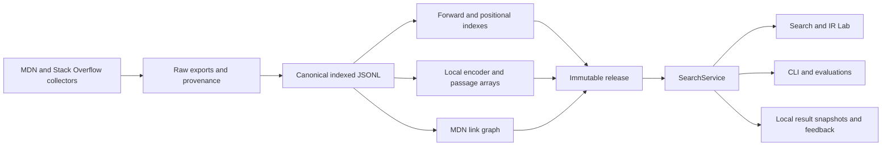

# TechSearch architecture

The supplied restart specification is the baseline for this repository. The file storage design uses JSONL for canonical records, binary lexical indexes, NumPy arrays for dense vectors, and JSON or CSV for manifests and analysis.

## Acquisition and canonicalization

The MDN adapter acquires an explicit source revision and stores the archive digest and collection diagnostics. The legacy root export is accepted with its provenance limited to the file and hash. The structured collector retains source text blocks, supported reference macro labels and targets, explicit anchors, code, and unresolved macro evidence. Only a fresh collection from source can repair losses in the legacy text. The SO collector resumes by question and answer IDs. The 5k pilot uses known quotas. The expansion stage rotates candidate tags and time windows, splitting capped ranges while preserving existing checkpoints. Scope admission requires browser/domain evidence appropriate to the tags. The raw files remain isolated from canonicalization.

Canonical IDs are stable source identities. A frozen snapshot assigns dense IDs by sorted stable IDs. MDN path lookup uses a casefolded alias key while source and display URLs preserve casing. SO question and answer aliases resolve to the question parent. Links preserve original occurrences, including out-of-corpus targets and anchors. Graph edges exclude self-links and duplicates. The induced graph includes only selected MDN parents. Browser compatibility explains existing MDN pages without creating parents.

## File repository and releases

`repository.Documents` keeps a compact catalog and stable ID map in memory. A byte-offset table addresses the full document record with one seek; request readers have independent cursors. Metadata postings for source, topic, and tag are computed at service startup. Corpus scans are confined to offline build and validation. Passage metadata has the same indexed JSONL design. Exact dense search maps NumPy files directly and scores eligible passage blocks.

Positional indexing externally sorts bounded batches of occurrences, consolidates runs by term and writes three encodings with equivalent data. Each lexicon stores document frequency, collection frequency, byte offset, payload length and meaningful bit length. Forward stats support direct access to weights and lengths. Forward term vectors have their own offsets. Search loads the lexicon once and decodes only queried terms. A query budget counts occurrences across decoded posting lists.

Canonical snapshots and releases are built in staging directories. Each manifest uses versioned schemas, stable relative input names, immutable file hashes, sizes and content-derived IDs. The active release pointer changes atomically after validation. Releases can reuse unaffected lexical, dense, and graph component files from the previous active release. A changed corpus can reuse individual parents' passage vectors from the verified previous release when all encoder and chunk settings and the ordered passage inputs match. Row and parent IDs are written for the new release. Startup checks existing artifacts without triggering build or acquisition.

Result snapshots and optional explicit judgments live separately under `data/runtime`. They are bound to a random session cookie, immutable release ID, and result ID. Recent snapshots are paginated by slicing a saved ranking. Explicit feedback can affect future equivalent queries for the same session and release. Snapshots expire after seven days, and a new search prunes aged snapshots for the current session.

## Querying and scoring

Keyword scoring uses casefolded original and identifier alias terms. Adjacent original token positions alone satisfy phrases. The parser builds a Boolean AST with `NOT > AND > OR`. Metadata, source/topic selectors and syntax constraints are applied before ranking, then checked again after fusion. Over-budget or invalid syntax returns an actionable error. Empty tokens produce no scored results. Filter-only or pure negative Boolean requests browse eligible IDs in stable order. Query repetitions contribute their accrued weight. OOV terms contribute no lexical score or query-likelihood factor.

BM25 uses `log(1 + (N - df + 0.5)/(df + 0.5))`, `k1=1.2`, `b=0.75`, and per-field length normalization with weighted field contributions. TF-IDF uses weighted linear document TF, smoothed `log((N+1)/(df+1)) + 1`, and global L2 normalization. A fielded term contributes only from matching fields. DAAT uses a document-ordered heap merge. TAAT accumulates term contributions before selecting the top results. Tie order follows dense parent IDs. Dirichlet uses a known-term background derived from collection occurrences and the corresponding document length including lexical aliases.

Dense rank computes a normalized float32 dot product with the local encoder and retains the highest qualifying passage for each eligible parent. Chunk windows use tokenizer offsets, stay within section and answer boundaries, and overlap on large sections. Code segments get their own windows. RRF adds `1/(k + rank)` for each available branch using 1-based parent ranks. The default `k` is 60. Manual modes report unavailable artifacts explicitly. Auto prefers hard syntax and identifiers, considers hybrid retrieval for conceptual queries, and uses a higher dense cutoff when no lexical candidate anchors the query. The cutoff is an initial setting with calibration pending.

PageRank uses dangling redistribution, damping, tolerance, and fixed tie ordering. Its optional bounded reranker moves MDN hits among their existing source slots. MMR uses rank-based relevance and term-set Jaccard overlap. Rocchio uses judged in-scope forward vectors and restricted expansion. LSI fits a deterministic truncated SVD sample of the sparse term-document matrix. K-means measures cluster size, inertia and sampled silhouette in that latent space.

## Evidence and research

API routes under `/api/v1` offer health and readiness, search and snapshot pagination, document detail, suggestions, feedback, comparisons, release statistics, reports, benchmarks, pipeline stage status, and exports. Both frontends render excerpt text and highlights through safe DOM APIs. The results carry links and attribution through the document viewer.

Conformance fixtures assert exact membership, positions, codec equality and storage behavior independently of the retrieval benchmark. The benchmark catalog has 25 intents per split in each of 12 classes. Freeze the catalog before tuning. Test judgments and results are kept out of threshold and routing selection. Provider annotation is explicit and pools ranked document IDs blind to method and ordering. Audit samples receive another judgment and disagreements receive adjudication. Evaluate P@5/P@10, nDCG@10, MRR@10 and pooled Recall@k only after the relevant pool is judged. Unavailable methods are reported and excluded from pair comparisons. The exported run includes hardware, repeats, release, candidate depth, query class, elapsed times, and build/disk information.
